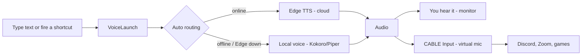

[English](README.md) · **Français**

# VoiceLaunch TTS

[](https://github.com/skarL007/sound_voice/actions/workflows/test.yml)
[](LICENSE)
[](https://github.com/skarL007/sound_voice/releases)
[](https://github.com/skarL007/sound_voice/releases/latest)

**Un lanceur de synthèse vocale gratuit et open source qui transforme votre saisie en véritable microphone pour Discord et n'importe quel jeu.**

Tapez une phrase → entendez une voix naturelle → elle sort par votre **micro virtuel**, et toutes les personnes de votre appel Discord ou de votre chat vocal en jeu l'entendent. Des centaines de voix Microsoft Edge TTS fonctionnent immédiatement, sans installation ni compte. Quand vous êtes hors ligne, une voix locale prend le relais automatiquement. Aucune télémétrie.

> Conçu pour les personnes qui ne peuvent pas ou préfèrent ne pas parler, pour les joueurs qui veulent une voix dans le chat, et pour toute personne qui a besoin d'une communication assistée, rapide et privée.

**🌐 Site web : [skarl007.github.io/sound_voice](https://skarl007.github.io/sound_voice/fr/)** · **⬇️ [Télécharger](https://github.com/skarL007/sound_voice/releases/latest)**

---

## Pourquoi VoiceLaunch

- **Votre voix dans Discord et dans n'importe quel jeu.** La parole générée est acheminée vers un micro virtuel (VB-Cable) : toute application qui lit un micro (Discord, Zoom, chat vocal en jeu) l'entend. VB-Cable est inclus dans l'installateur et se configure tout seul.
- **Routage intelligent des voix.** En mode **Auto**, l'application utilise Edge TTS en ligne quand vous avez internet, puis bascule instantanément sur une voix locale (Kokoro/Piper) quand vous êtes hors ligne ou que la connexion tombe, sans aucun réglage à changer.
- **Instantané, sans compte.** Des centaines de voix Edge TTS naturelles fonctionnent dès l'ouverture de l'application. Rien à télécharger, aucune inscription, aucune télémétrie.
- **Raccourcis vocaux globaux.** Associez une phrase à un raccourci et déclenchez-la depuis un jeu sans quitter la fenêtre.
- **Pensé pour l'accessibilité.** Historique et brouillon persistants, phrases rapides, clavier virtuel, modes contraste élevé et grande police, navigation complète au clavier et focus visible.

---

## Installation

### Téléchargement (recommandé)

1. Rendez-vous sur [Releases](https://github.com/skarL007/sound_voice/releases/latest).
2. Téléchargez le dernier installateur (`VoiceLaunch-TTS-Setup-<version>.exe`).
3. Lancez-le. Le **VB-Audio Virtual Cable** inclus s'installe automatiquement s'il n'est pas déjà présent (un redémarrage de Windows peut être nécessaire).

#### Windows SmartScreen

Cette version open source n'est pas signée : Windows affiche donc **« Windows a protégé votre ordinateur »**. Cliquez sur **Informations complémentaires → Exécuter quand même**. C'est normal pour un installateur non signé.

#### Vérifier le téléchargement (facultatif mais recommandé)

Chaque version publie le SHA-256 de l'installateur. Vérifiez que votre téléchargement correspond :

```powershell
Get-FileHash -Algorithm SHA256 .\VoiceLaunch-TTS-Setup-<version>.exe
```

Comparez le résultat avec l'empreinte indiquée dans les [notes de version](https://github.com/skarL007/sound_voice/releases/latest).

### Configuration requise

| Élément | Minimum | Recommandé |
|---------|---------|------------|
| Système | Windows 10 x64 | Windows 11 x64 |
| Mémoire vive | 4 Go | 8 Go |
| Stockage | 2 Go libres | 10 Go (pour les modèles locaux) |
| GPU | Indifférent (Edge TTS fonctionne sur tout matériel) | NVIDIA avec CUDA (pour le clonage XTTS v2) |
| Internet | Requis pour les voix Edge TTS dans le cloud | Facultatif une fois les modèles locaux téléchargés |

---

## L'utiliser dans Discord (ou n'importe quel jeu)

1. Ouvrez VoiceLaunch et activez le **micro virtuel** (l'application sélectionne automatiquement `CABLE Input`).
2. Dans Discord : **Paramètres → Voix et vidéo → Périphérique d'entrée → `CABLE Output (VB-Audio Virtual Cable)`**.
3. Tapez une phrase et cliquez sur **Parler**, ou déclenchez un **raccourci vocal** pendant que le jeu a le focus.

Toutes les personnes du salon entendent désormais votre voix générée. Le même périphérique `CABLE Output` fait office de « microphone » dans les réglages de chat vocal de n'importe quel jeu.

---

## Développement

### Prérequis

- Windows 10/11
- Node.js 20+
- Python 3.12 (uniquement pour construire le backend local inclus)

### Démarrage rapide

```sh
git clone https://github.com/skarL007/sound_voice.git
cd sound_voice
npm install
npm run dev
```

L'application s'ouvre avec les voix Edge TTS du cloud immédiatement opérationnelles. Les voix locales (Piper/Kokoro) nécessitent le backend Python empaqueté : voir [CONTRIBUTING.fr.md](CONTRIBUTING.fr.md).

### Vérifier

```sh
npm run type-check
npm test
```

### Construire l'installateur

```sh
npm run dist:win
```

Pour l'architecture et l'articulation des différents éléments, voir [docs/fr/ARCHITECTURE.md](docs/fr/ARCHITECTURE.md).

---

## Fonctionnement



Le chemin cloud est rendu dans l'application elle-même, qui diffuse l'audio vers le périphérique du micro virtuel ; le chemin local est rendu dans le backend Python. Voir [docs/fr/ARCHITECTURE.md](docs/fr/ARCHITECTURE.md) pour une vue d'ensemble complète.

## Voix

| Modèle | Statut | Remarques |
|--------|--------|-----------|
| Edge TTS (cloud) | Par défaut | Des centaines de voix, sans installation, nécessite internet |
| Piper | Stable (local) | Léger, uniquement CPU, fonctionne hors ligne |
| Kokoro | Stable (local) | Meilleure qualité (MOS 4,2), reste adapté au CPU |
| XTTS v2 | Avancé (local) | Clonage de voix ; NVIDIA + CUDA uniquement |
| MeloTTS / Fish Speech / Bark | Expérimental | En dehors du parcours principal |

En mode Auto, les voix locales sont choisies automatiquement selon le niveau du matériel. Le parcours local recommandé est Piper d'abord, puis Kokoro pour une meilleure qualité.

## Organisation du dépôt

```text
src/
  main/       Electron main process (lifecycle, IPC, Python backend, Edge TTS client)
  preload/    secure context bridge to the renderer
  renderer/   React app (Speak, Shortcuts, Settings, compact mode)
  python/     FastAPI backend and TTS engine wrappers
  shared/     shared TypeScript types
docs/         architecture, accessibility, virtual mic, release validation
```

## Documentation

- [Architecture](docs/fr/ARCHITECTURE.md)
- [Accessibilité](docs/fr/ACCESSIBILITY.md)
- [Guide du micro virtuel](docs/fr/VIRTUAL_MIC.md)
- [Protocole de validation des versions](docs/fr/RELEASE_VALIDATION.md)
- [Contribuer](CONTRIBUTING.fr.md)
- [Politique de sécurité](SECURITY.md) (en anglais)

## Données et journaux

- Journaux : `%APPDATA%\voicelaunch-tts\logs\`
- Modèles : `%APPDATA%\voicelaunch-tts\models\`
- Voix clonées : `%APPDATA%\voicelaunch-tts\voices\`

## Licence

MIT : voir [LICENSE](LICENSE).
